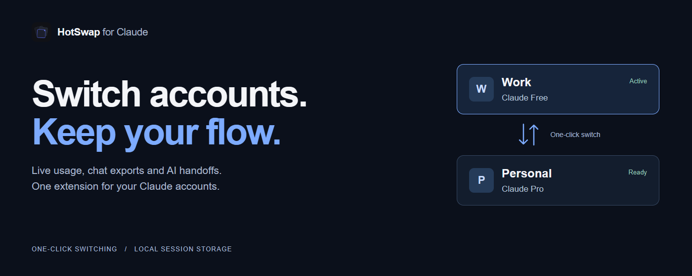
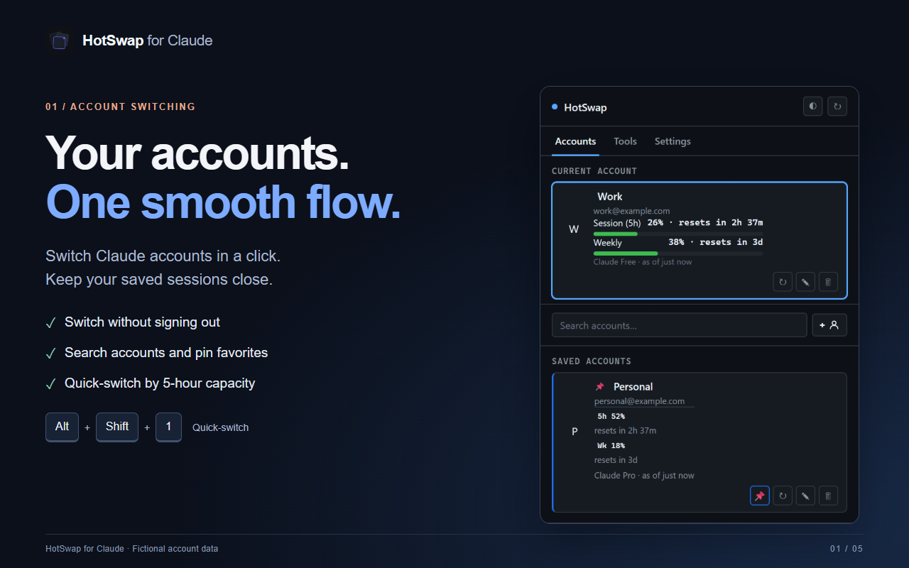
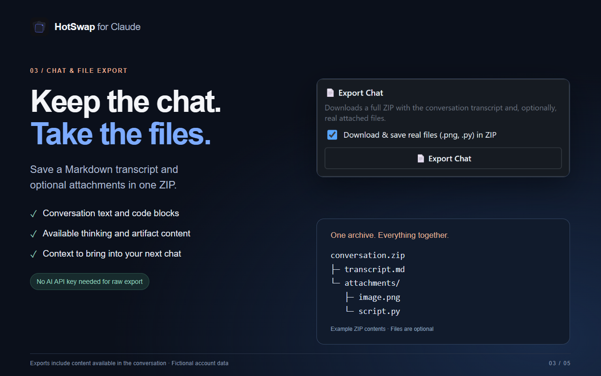
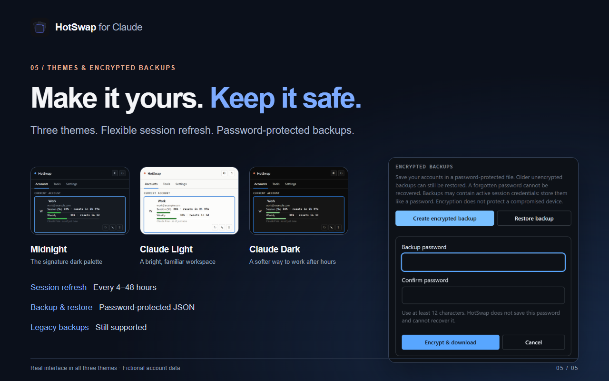

# HotSwap for Claude

**Switch Claude accounts. Keep your flow.**

Save your accounts, see their usage, and bring useful context into your next chat—all from one browser extension.

[](https://chromewebstore.google.com/detail/hotswap-for-claude/nnpnmjhealgmnbinplmccegkecabcpdk)
[](https://addons.mozilla.org/en-US/firefox/addon/hotswap-for-claude/)



## What you can do

- **Switch and organize accounts.** Save, rename, search, and pin your Claude logins. Switch in a click, cycle with shortcuts, or quick-switch to the account with the most available session quota in the latest usage data.
- **See usage and reset times.** Check session, weekly, and model limits where Claude provides them. Refresh one account or all of them, and get a desktop alert when an exhausted session resets.
- **Keep accounts ready.** Choose background refresh every 4, 8, 12, 24, or 48 hours. Expired or revoked logins may still need you to sign in again.
- **Export your conversation.** Download a ZIP with a Markdown transcript, thinking, and optional images, code, artifacts, and attachments. The save confirmation shows the actual full file path. Raw exports need no AI API key.
- **Create a Gemini handoff.** Preview and copy a summary for your next chat using your own API key, encrypted locally. Summaries send selected conversation content and optional file/code context to Google; Google's terms and charges apply.
- **Back up with a password.** Create encrypted v2 account backups with a confirmed password of at least 12 characters. Restore v1 encrypted files or older unencrypted backups after reviewing and confirming the account list. HotSwap never saves or recovers the backup password. See the [backup format](docs/security/backup-format.md).
- **Choose your theme.** Use Midnight, Claude Light, or Claude Dark.

Each Claude account keeps its own plan and limits. Switching does not move the original conversation; export or summarize its context and bring it into a new chat yourself.

## Get started

1. Sign in to Claude, open HotSwap, and save your current account with a label you recognize.
2. Choose **Start new account**, sign in to another account, and save it too.
3. Click a saved account or use a shortcut. Check usage in **Accounts**, export or summarize in **Tools**, and manage preferences in **Settings**.

Default shortcuts: **Alt + Shift + → / ←** to cycle, and **Alt + Shift + 1** to quick-switch. On Mac, use **Option** in place of Alt. Customize shortcuts in your browser.

## Take a look inside

### Accounts and usage



### Conversation exports



### Themes and encrypted backups



## Privacy

Saved accounts and settings stay in your browser. Your saved Gemini key is encrypted with a browser-managed key and unlocks automatically in the background. Optional summaries communicate directly with Google; account and usage requests go directly to Claude. The extension has no analytics or tracking.

Account backups contain sensitive login data. Keep the encrypted file and its password safe. Local encryption does not protect against someone with control of your browser profile or device.

[Privacy & Data](https://hotswap.jeddah.dev/privacy)

## Build and load locally

Run the dependency-free packager with Python:

```sh
python package.py
```

It creates browser-specific ZIPs and unpacked folders in `dist/`.

- **Chrome / Chromium:** open `chrome://extensions`, enable Developer mode, choose **Load unpacked**, and select `dist/chrome/`.
- **Firefox:** open `about:debugging#/runtime/this-firefox`, choose **Load Temporary Add-on**, and select `dist/firefox/manifest.json`.

Ready-made packages and their changelog are available on the [GitHub Releases page](https://github.com/iammarxg/hotswap-for-claude/releases/latest).

## Help and license

[Website](https://hotswap.jeddah.dev) · [Support](https://hotswap.jeddah.dev/#support) · [Email](mailto:support@jeddah.dev) · [Report an issue](https://github.com/iammarxg/hotswap-for-claude/issues)

Licensed under the [GNU Affero General Public License](LICENSE).

HotSwap for Claude is an independent project, not affiliated with, endorsed by, or sponsored by Anthropic.
