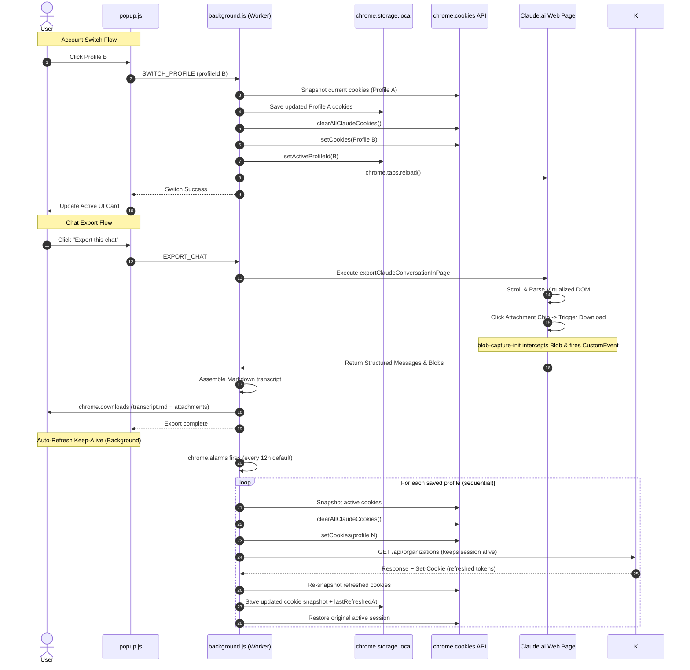

# HotSwap for Claude — Architecture & System Guide

This document provides a comprehensive technical overview of the Chrome Extension codebase for AI agents, developers, and maintainers.

---

## 1. Overview & Core Purpose

The **HotSwap for Claude (v1.0.0)** is a Manifest V3 Chrome extension designed to solve three main problems when using Claude.ai:

1. **Multi-Account Switching without Token Revocation**:
   - Claude.ai's authentication cookies are `HttpOnly`, which content scripts cannot read or write.
   - Claude's native "Log out" button revokes the session token server-side.
   - This extension uses the background `chrome.cookies` API to take snapshots of active sessions and switch between them cleanly. It provides a "Start new account" flow that only clears local cookies, preserving token validity.

2. **Direct Usage Limit Tracking**:
   - Instead of depending on third-party extensions or DOM scraping, it queries Claude's `/api/organizations/{orgId}/usage` endpoint directly.
   - Tracks 5-hour session limits, 7-day weekly limits, and model-specific caps (Sonnet, Opus, Fable).
   - Allows checking usage for inactive accounts by performing invisible background cookie swaps.

3. **Client-Side Conversation & Attachment Export**:
   - Scrapes conversation turns from the virtualized DOM directly to Markdown with zero token cost.
   - Captures user-uploaded attachments, artifacts, and pasted text using an early `URL.createObjectURL` proxy in the main JavaScript execution realm (`MAIN` world).

---

## 2. Directory Structure & Workflow

The repository is organized into a **Development Path** (where bug fixes and features are built and tested), a clean **Production Path** (for Google Chrome Web Store publishing), and a versioned **Store Assets** archive:

```
hotswap-for-claude-extension/
├── src/                                # [PUBLIC / OPEN-SOURCE DEV PATH]
│   ├── manifest.json                   # MV3 manifest
│   ├── background.js                   # Service worker & core logic
│   ├── blob-capture-init.js            # Early MAIN world blob proxy
│   ├── export-page-script.js           # In-page DOM scraper
│   ├── popup.html                      # Popup markup (Accounts, Tools, Settings tabs)
│   ├── popup.js                        # Popup client logic
│   ├── popup.css                       # Popup styling & macOS width lock
│   ├── icons/                          # Extension icons (16px, 48px, 128px)
│   ├── LICENSE                         # Creative Commons CC BY-NC 4.0 License
│   ├── README.md                       # Developer & user documentation
│   └── ARCHITECTURE.md                 # System architecture guide
│
├── dist/                               # [PRIVATE / CHROME WEB STORE PRODUCTION BUILD]
│   ├── manifest.json                   # Production manifest (clean, no dev notes)
│   ├── background.js                   # Production service worker
│   ├── blob-capture-init.js            # Production blob interceptor
│   ├── export-page-script.js           # Production export script
│   ├── popup.html                      # Production popup UI
│   ├── popup.js                        # Production popup JS
│   ├── popup.css                       # Production popup CSS
│   └── icons/                          # Production icon assets
│
└── store-assets/                       # [PRIVATE / VERSIONED STORE & MARKETING ASSETS]
    └── v1.0.0/                         # Version archive folder (v1.0.0, v1.1.0, etc.)
        ├── hotswap-for-claude-v1.0.0.zip # Full extension package snapshot zip
        ├── icon512.png                 # High-resolution master icon (512x512)
        ├── icon128.png                 # Store listing icon (128x128)
        ├── icon48.png / icon16.png     # Scaled icons
        ├── promo_small_440x280.png     # Small promo tile (440x280, 24-bit RGB)
        ├── promo_marquee_1400x560.png  # Marquee promo banner (1400x560, 24-bit RGB)
        └── screenshot_*.png            # Store listing showcase screenshots (1280x800)
```

### 📋 Mandatory Release & Maintenance Workflow Rules (For All Agents & Maintainers)

1. **Development & Testing Sandbox**: All active feature development, bug fixes, and experiments occur inside `src/`.
2. **Production Mirroring**: Once verified, clean runtime files (`manifest.json`, `background.js`, `blob-capture-init.js`, `export-page-script.js`, `popup.*`, `icons/`) are synced to `dist/` without development documentation, licenses, or scratch files.
3. **Version Bump & Asset Snapshots**:
   - For every release or published feature update, bump the version (`manifest.json` and `ARCHITECTURE.md`).
   - Create a version folder in `store-assets/vX.Y.Z/`.
   - **Always generate a zip snapshot** of the production extension files (`hotswap-for-claude-vX.Y.Z.zip`) inside `store-assets/vX.Y.Z/` alongside screenshots and icon assets.
4. **Git Subtree Publishing**:
   - Push `src/` to the public repository using `git subtree push --prefix=src public-origin main`.
   - Production builds (`dist/`) and marketing assets (`store-assets/`) remain private on `origin main`.
5. **Mandatory Documentation Updates**:
   - **Always** update `README.md` and `ARCHITECTURE.md` on every feature modification, architectural change, or workflow update—even if the prompt does not explicitly request it.

---

## 3. Detailed Component Breakdown

### `manifest.json`
- **Manifest Version**: 3
- **Permissions**: `cookies`, `storage`, `tabs`, `scripting`, `downloads`, `alarms`
- **Host Permissions**: `https://claude.ai/*`, `https://*.claude.ai/*`
- **Background**: Service worker (`background.js`, ES module)
- **Content Scripts**: `blob-capture-init.js` registered for `https://claude.ai/*` with `run_at: "document_start"` and `world: "MAIN"`.
- **Keyboard Shortcuts**:
  - `cycle-next-account` (`Alt+Shift+Right` / `⌥⇧→`)
  - `cycle-prev-account` (`Alt+Shift+Left` / `⌥⇧←`)
  - `quick-switch-1` (`Alt+Shift+1` / `⌥⇧1` — switches to account with lowest 5-hour limit utilization)

---

### `background.js`
The background service worker acts as the central controller:

- **Cookie Management**:
  - `getAllClaudeCookies()`: Retrieves cookies for `claude.ai` and `.claude.ai` without hardcoding names to prevent breakage if Claude renames auth cookies.
  - `clearAllClaudeCookies()`: Iterates through captured cookies and removes them using `chrome.cookies.remove({ url, name })`.
  - `setCookies(cookies)`: Restores cookies, carefully preserving `expirationDate` for persistent cookies while omitting it for session-only cookies to avoid Chrome store rejection.
- **Account Operations**:
  - `addCurrentAccount(label)`: Snapshots live cookies, extracts email from the DOM, queries initial usage, and stores the profile in `chrome.storage.local`.
  - `switchToProfile(profileId)`: Re-syncs the active profile (to preserve rotated tokens), clears cookies, writes the target profile's cookies, and reloads open Claude tabs.
  - `prepareForNewAccount()`: Syncs the active profile, wipes local cookies without calling Claude's logout API, and navigates to `https://claude.ai/login`.
- **Direct Usage Fetching**:
  - `fetchUsageForActiveSession()`: Identifies `orgId` via `lastActiveOrg` cookie or `/api/organizations`, then calls `/organizations/${orgId}/usage` and `/bootstrap/${orgId}/app_start`.
  - `getUsageForProfile(profileId)`: For inactive profiles, temporarily saves the active session, swaps in the target profile's cookies, fetches usage, and immediately swaps back without reloading tabs.
- **Chat Export & Download Management**:
  - Injects `exportClaudeConversationInPage` via `chrome.scripting.executeScript`.
  - `withCapturedDownloads()`: Listens to `chrome.downloads.onCreated` to catch downloads triggered by JavaScript in the page.
  - Writes `transcript.md` and attachment files into a dedicated export folder (`claude-chat-export-<title>-<timestamp>/`).
- **Backup & Restore**:
  - Serializes all profiles and raw session cookies into a downloadable JSON backup file.
  - Imports backups, assigning fresh UUIDs to prevent clobbering existing accounts.
- **Auto-Refresh / Session Keep-Alive**:
  - `refreshProfileSession(profileId)`: Swaps cookies to the target profile, hits `GET /api/organizations` to exercise the session (triggering any `Set-Cookie` token rotations), re-snapshots the refreshed cookies, and opportunistically refreshes usage data.
  - `refreshAllProfileSessions()`: Iterates all profiles sequentially (shared cookie jar prevents concurrency).
  - `setupAutoRefresh()`: Creates or clears a `chrome.alarms` timer based on user settings (default: every 12 hours, enabled by default).
  - `chrome.alarms.onAlarm` listener: Fires `refreshAllProfileSessions()` when the alarm triggers.
  - `chrome.runtime.onInstalled` listener: Initializes the alarm on first install or extension update.

---

### `blob-capture-init.js`
- Runs in the **`MAIN` world** at **`document_start`** before Claude.ai's JavaScript bundles load.
- Wraps `URL.createObjectURL`. When Claude generates an attachment blob upon clicking preview/download, this script intercepts the `Blob`, reads it as a Base64 Data URL using `FileReader`, and dispatches a `__claude_export_blob_captured` custom DOM event.
- Crucial because content scripts running in isolated worlds cannot intercept cached function references inside Claude's bundled code.

---

### `export-page-script.js`
- Self-contained function (`exportClaudeConversationInPage`) executed in the page context.
- **Virtualization Traversal**: Claude virtualizes long chats. The script steps through `scrollTop = 0` on `[data-autoscroll-container="true"]`, waiting for heights to stabilize, and captures message turns indexed by `aria-posinset`.
- **Message DOM Parsing**: Selects message containers via `[role="article"][aria-label^="Message "]`, role headings (`sr-only` "You said" / "Claude responded"), and markdown elements (`pre`, `code`, `li`, `blockquote`, etc.).
- **Attachment & Artifact Resolution**:
  - Detects `img`, download `a[href]`, and thumbnail chips (`[data-testid*="file-thumbnail"]`).
  - Programmatically clicks thumbnail buttons to mount the download button, clicks it, and awaits the `__claude_export_blob_captured` event.
  - Extracts full pasted text from collapsible chips.

---

### `popup.html`, `popup.js`, and `popup.css`
- **UI Architecture**:
  - Tab 1: **Accounts** — Displays active account card with full usage progress bars, search bar, add account section, and saved accounts list.
  - Tab 2: **Tools** — Export chat button and resume prompt copy button (`Resume elsewhere`).
  - Tab 3: **Settings** — **Session keep-alive** settings (toggle, interval selector, status, manual refresh), **Keyboard shortcuts** reference list with direct link to Chrome shortcut editor, and **Backup & Restore** controls.
- **Usage & Health Visualization**:
  - Computes relative reset times (`resets in 2h 15m` vs `resets in 3d 4h`).
  - Applies color heat maps: Cool (<70%), Warm (70–89%), Hot (≥90%).
  - Checks cookie metadata expiration dates to display health dots: green (valid), amber (expiring ≤ 3 days), red (expired/missing), grey (session-only).

---

## 4. Architectural Sequence Diagram



---

## 5. Key Design Principles & Maintenance Notes

1. **Zero External Dependencies**: Built entirely with standard Web & Chrome Extensions APIs (MV3, Vanilla JS, CSS variables).
2. **Never Call Native Logout**: The extension strictly clears local cookies when initiating a new session. Server-side logout destroys session credentials permanently.
3. **Resilient Selectors**: When scraping Claude.ai, structural and accessibility attributes (`aria-posinset`, `[role="article"]`, screen-reader headings) are prioritized over dynamic or minified Tailwind class names.
4. **Sequential Cookie Swapping**: When refreshing usage or sessions for multiple accounts (`REFRESH_ALL_USAGE`, `REFRESH_ALL_SESSIONS`), requests run sequentially to prevent race conditions in the shared browser cookie jar.
5. **Graceful Auto-Refresh Degradation**: The `chrome.alarms`-based keep-alive fires periodically and attempts every saved profile. If one profile's session has already been revoked server-side, the refresh fails gracefully for that profile and continues with the rest — no cascading failures.
